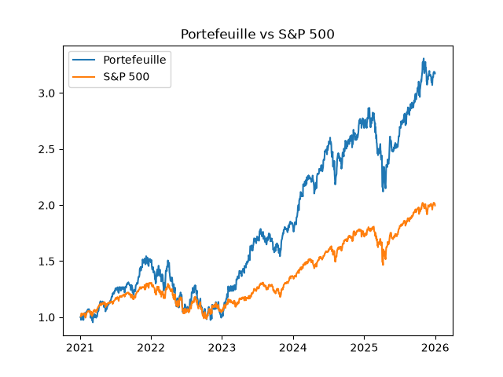
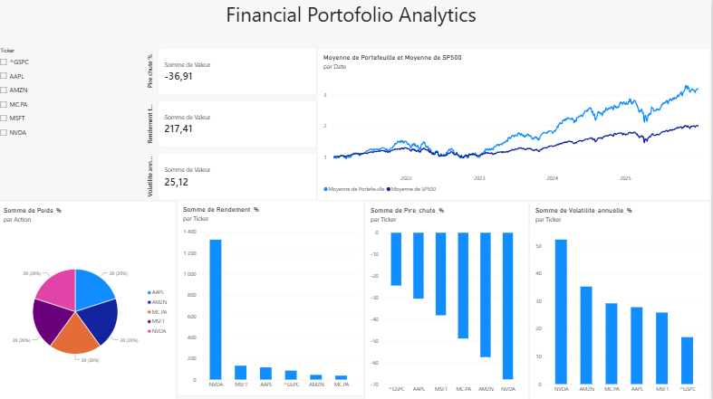

# Financial Portfolio Analytics

[Français](#français) | [English](#english)

---

## Français

### Objectif
Répondre à la question : *« Si j'avais investi dans plusieurs actions, comment mon portefeuille aurait-il évolué et quel niveau de risque aurais-je pris ? »*

### Données
- Prix de clôture journaliers (2021-2025) récupérés avec `yfinance`
- Portefeuille fictif : Apple, Microsoft, Nvidia, Amazon, LVMH (20 % chacune)
- Indice de référence : S&P 500

### Méthodologie
1. Récupération des données avec Python
2. Calcul du rendement total, des rendements journaliers, de la volatilité annuelle et du maximum drawdown
3. Construction du portefeuille et comparaison au S&P 500
4. Export des résultats en CSV et dashboard Power BI

### Résultats

| Mesure | Portefeuille |
|---|---|
| Rendement total | +217 % |
| Volatilité annuelle | 25,1 % |
| Pire chute (max drawdown) | -36,9 % |

Le S&P 500 a fait +85 % sur la même période, avec une pire chute de -24,4 %.

### Conclusions
- Le portefeuille a surperformé le S&P 500, mais avec plus de risque.
- Nvidia a le meilleur rendement (+1326 %) mais aussi la plus forte volatilité (≈ 52 %).
- Mélanger plusieurs actions réduit la volatilité par rapport à Nvidia seule.

### Limites
- Résultats basés sur le passé, qui ne garantissent pas l'avenir.
- LVMH est cotée en euros et les autres en dollars : aucune conversion de devise n'a été faite.
- Les poids sont supposés rééquilibrés à 20 % chaque jour.
- Projet pédagogique : ce n'est pas un conseil en investissement.

### Technologies
Python, pandas, yfinance, matplotlib, Power BI

### Fichiers
- `main.py` : script d'analyse
- `resultats.csv`, `stats_actions.csv`, `stats_portefeuille.csv`, `composition.csv` : données exportées
- `dashboard.pbix` : dashboard Power BI

---

## English

### Goal
Answer the question: *"If I had invested in several stocks, how would my portfolio have performed and how much risk would I have taken?"*

### Data
- Daily closing prices (2021-2025) retrieved with `yfinance`
- Fictional portfolio: Apple, Microsoft, Nvidia, Amazon, LVMH (20% each)
- Benchmark: S&P 500

### Methodology
1. Data retrieval with Python
2. Computation of total return, daily returns, annualized volatility and maximum drawdown
3. Portfolio construction and comparison with the S&P 500
4. Results exported to CSV and a Power BI dashboard

### Results

| Metric | Portfolio |
|---|---|
| Total return | +217% |
| Annualized volatility | 25.1% |
| Maximum drawdown | -36.9% |

The S&P 500 returned +85% over the same period, with a maximum drawdown of -24.4%.

### Conclusions
- The portfolio outperformed the S&P 500, but with more risk.
- Nvidia had the best return (+1326%) but also the highest volatility (≈ 52%).
- Mixing several stocks lowers volatility compared with Nvidia alone.

### Limitations
- Based on past data, which does not guarantee future results.
- LVMH is priced in euros and the others in dollars: no currency conversion was applied.
- Weights are assumed to be rebalanced to 20% every day.
- Educational project: this is not investment advice.

### Technologies
Python, pandas, yfinance, matplotlib, Power BI

### Files
- `main.py`: analysis script
- `resultats.csv`, `stats_actions.csv`, `stats_portefeuille.csv`, `composition.csv`: exported data
- `dashboard.pbix`: Power BI dashboard